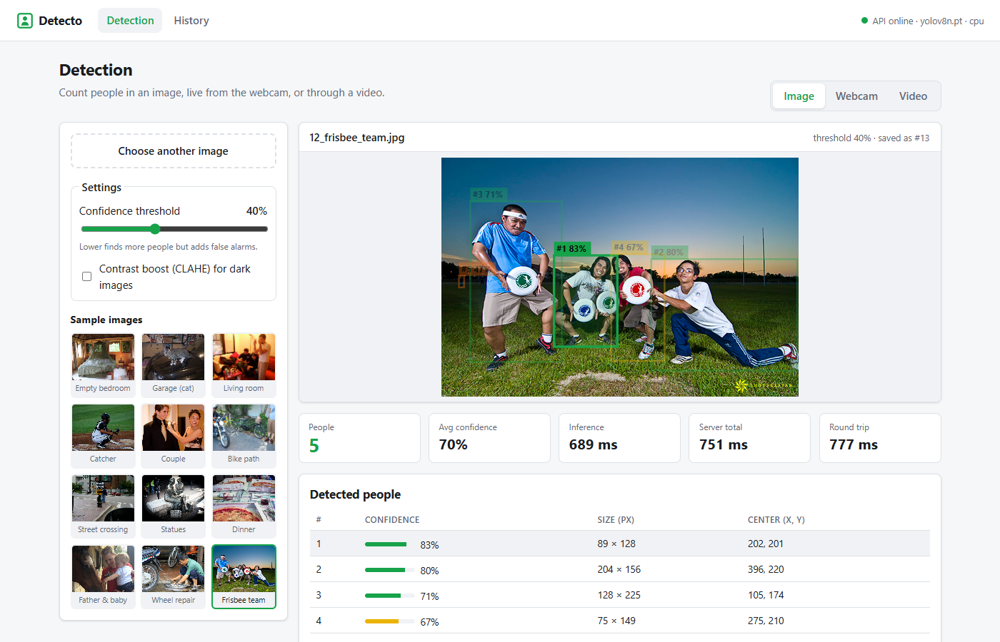
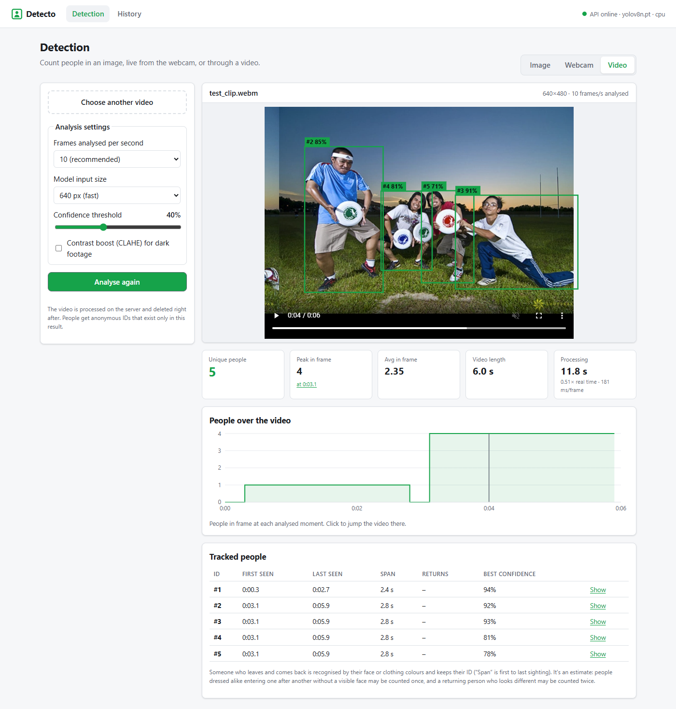
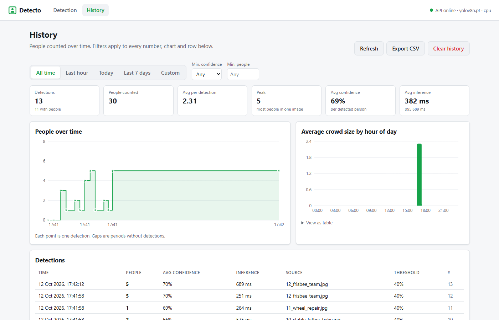

# Detecto

Real-time person detection and counting for monitoring spaces such as entrances,
classrooms and warehouses. Detecto finds people in **images**, a **live webcam** or
an **uploaded video**, draws a box and confidence score around each person, and
keeps a **history** of counts for later analysis.

Built with **FastAPI** + **YOLOv8** (Ultralytics) on the backend and **React** + **Vite**
on the frontend. Runs on a normal laptop CPU; no GPU needed.



## What it does

- **Image detection**: upload a JPEG/PNG (or pick one of 12 sample images) and get the
  number of people, a box and confidence per person, and processing times. Hover a
  person in the table to highlight their box.
- **Live webcam**: detection on camera frames (~5–10 frames per second on CPU) with
  **tracking**: each person keeps an ID (`#3`) while visible, and a **unique people**
  count. Someone who walks out of view and comes back is **re-identified** and keeps
  their ID (by face or clothing colours).
- **Video analysis**: upload an MP4/WebM/MOV, then watch your video with the tracked
  boxes drawn on top, a "people over time" chart, and a table of everyone tracked
  (first seen, last seen, returns).
- **Face recognition (optional)**: enrol people (with their consent) from a few
  photos; the webcam view then labels them by name.
- **History**: every saved detection with filters (date range, confidence, people
  count), KPI tiles, a people-over-time chart, average crowd size per hour of day,
  and **CSV export**.





*Screenshots taken from the Docker version on Windows, which runs slower than a native
install (see [Evaluation results](#evaluation-results)).*

## How it works

```
 Browser (React + Vite)                        Backend (FastAPI)
 ┌──────────────────────────┐   HTTP/JSON   ┌───────────────────────────────────────┐
 │ Image | Webcam | Video   │ ────────────▶ │ validate → resize/CLAHE → YOLOv8n      │
 │ History (charts, filters)│ ◀──────────── │  → ByteTrack (IDs) → re-identification │
 └──────────────────────────┘               │  → optional face match (YuNet + SFace) │
                                            │  → SQLite history (counts, not images) │
                                            └───────────────────────────────────────┘
```

- The detector is **YOLOv8n** trained on COCO, filtered to the `person` class.
- Webcam frames are sent one at a time (the next frame only after the previous result),
  analysed at 640 px for speed; uploaded images at 1280 px to also find small or distant people.
- Videos are processed as a background job; the browser plays your own copy of the
  video and draws the returned tracks in sync (no re-encoding on the server).

## Run with Docker (easiest)

**Requires:** [Docker Desktop](https://www.docker.com/products/docker-desktop/) (running).

```bash
docker compose up --build -d
```

Then open **http://localhost:8080**. The API documentation is at http://localhost:8000/docs.

The first build takes ~5–10 minutes (it downloads CPU-only PyTorch); later builds are fast.

| Command | What it does |
|---|---|
| `docker compose up -d` | Start (after the first build) |
| `docker compose logs -f backend` | Follow the backend log |
| `docker compose down` | Stop; history and enrolled faces are kept |
| `docker compose down -v` | Stop and **delete all stored data** |

If port 8000 or 8080 is already in use, choose other ones:

```powershell
# PowerShell
$env:DETECTO_API_PORT="8001"; $env:DETECTO_WEB_PORT="8081"; docker compose up -d
```
```bash
# macOS / Linux
DETECTO_API_PORT=8001 DETECTO_WEB_PORT=8081 docker compose up -d
```

Notes:
- Model weights are built into the image, so it works offline once built. If
  `backend/weights/` already contains them, the build uses those copies.
- Data (SQLite database, log) lives in the Docker volume `detecto-data`.
- The **webcam** works at `http://localhost:8080`. Browsers only allow camera access on
  `localhost` or HTTPS, so opening the app from another computer requires HTTPS.

## Run without Docker

**Requires:** Python 3.13 and Node.js 22 (with npm).

### 1. Backend

From the project folder:

```powershell
# Windows (PowerShell)
python -m venv .venv
.\.venv\Scripts\python.exe -m pip install -r requirements.txt
.\.venv\Scripts\python.exe scripts\download_face_models.py   # face recognition models (~39 MB)
Copy-Item .env.example .env
.\.venv\Scripts\python.exe -m uvicorn backend.main:app --reload
```

```bash
# macOS / Linux
python3 -m venv .venv
.venv/bin/python -m pip install -r requirements.txt
.venv/bin/python scripts/download_face_models.py
cp .env.example .env
.venv/bin/python -m uvicorn backend.main:app --reload
```

Wait for `Application startup complete`. The YOLOv8n weights (~6 MB) download
automatically on the first start. The API runs at http://127.0.0.1:8000 (docs at `/docs`).

> On Windows, start the Python path with `.\` (as above). Without it, PowerShell reads
> `.venv\Scripts\python.exe` as a module name and fails.

### 2. Frontend

In a second terminal:

```powershell
cd frontend
npm install
Copy-Item .env.example .env     # macOS / Linux: cp .env.example .env
npm run dev
```

Open **http://localhost:5173**. The green "API online" badge in the top-right shows the
frontend can reach the backend.

## Configuration

All backend settings are environment variables prefixed with `DETECTO_`, read from `.env`.
[`.env.example`](.env.example) lists every option with a comment. The most useful ones:

| Variable | Default | Meaning |
|---|---|---|
| `DETECTO_CONF_THRESHOLD` | `0.4` | Minimum confidence for a detection |
| `DETECTO_IMG_SIZE` | `1280` | Model input size for images (640 is ~3× faster, finds fewer small people) |
| `DETECTO_DEVICE` | `cpu` | Use `0` for the first CUDA GPU |
| `DETECTO_REID_ENABLED` | `true` | Recognise people who leave and come back |
| `DETECTO_MAX_VIDEO_MB` | `200` | Largest video upload |

The frontend has one setting, `VITE_API_URL` in `frontend/.env` (default `http://127.0.0.1:8000`).

## Tests

```powershell
.\.venv\Scripts\python.exe -m pytest backend/tests -q     # backend (132 tests)
cd frontend; npm test                                      # frontend (82 tests)
```

The backend tests use a temporary database and never touch your data. Optional
frontend tests against a running backend: `$env:API_INTEGRATION=1; npm test`.

## Evaluation results

Measured with `scripts/evaluate.py` on 12 COCO val2017 images (25 people, counted by hand
in [`backend/samples/ground_truth.json`](backend/samples/ground_truth.json)), YOLOv8n,
1280 px, threshold 0.4, native install on a laptop CPU:

| Metric | Target | Result |
|---|---|---|
| Detection accuracy (correct ÷ visible people) | ≥ 85 % | **96.0 %** (24 / 25) ✅ |
| False positives (extra boxes ÷ all boxes) | ≤ 10 % | **4.0 %** (1 / 25) ✅ |
| Average inference time per image | ≤ 1.5 s | **~210 ms** ✅ |
| Average confidence of detections | ≥ 0.7 | **0.68** ❌ |
| Reliability (images processed without errors) | 100 % | **100 %** ✅ |

- The miss was a motorcyclist cut off at the image edge; the false positive was a bronze statue.
- Average confidence falls just short because hard cases (dim light, partly hidden
  people, a baby) are found but with lower confidence; raising the threshold would
  increase confidence but miss more people.
- Larger models (YOLOv8s/m) and YOLO26n were compared and were not more accurate on
  these images; the input size (1280 vs 640) mattered much more.
- In Docker on Windows, inference is slower (~250–700 ms per image) because Docker runs
  inside a virtual machine with less CPU available.

Full per-image results: [`backend/evaluation/results.md`](backend/evaluation/results.md).
Re-run with `.\.venv\Scripts\python.exe scripts\evaluate.py`.

## Privacy

- **No images are stored.** History keeps counts, boxes and timings, not pictures.
  Uploaded videos are deleted as soon as they are processed.
- **Tracking IDs are anonymous** and exist only for one camera session or video.
  Appearance data used to recognise returning people stays in memory and is discarded
  when the session ends.
- **Face recognition is opt-in and consent-based.** Enrolment requires a consent
  checkbox; only face embeddings (128 numbers per photo) are stored, never the photos,
  and deleting a person removes all their face data. Names seen live are never saved
  to history.

## Limitations

- People who are heavily occluded, very small or cut off at the image edge can be missed.
- Re-identification is an estimate: someone who returns looking different (other
  jacket, face hidden) may be counted twice; people dressed alike who enter one after
  another without a visible face may be counted once.
- Face recognition has no liveness check, so a photo of an enrolled person would be
  recognised. It's meant for labelling, not for access control.
- Video jobs and live sessions are kept in memory and are lost when the backend restarts.

## Project structure

```
backend/
  main.py            FastAPI app (CORS, logging, routers)
  config.py          settings from DETECTO_* environment variables
  routes/            detect, history, stats, faces, videos
  services/          detector (YOLO), tracking (ByteTrack), reid, faces, video, pipeline
  db.py, face_store.py   SQLite storage
  samples/           12 test images + ground_truth.json
  evaluation/        evaluation results and overlay images
  tests/             pytest suite
frontend/
  src/pages/         Detection (Image | Webcam | Video) and History pages
  src/components/    upload, webcam, video, charts, tables
  src/api.js         API client
scripts/
  evaluate.py               accuracy / speed evaluation on the samples
  download_face_models.py   fetches the OpenCV face models
docker-compose.yml, backend/Dockerfile, frontend/Dockerfile, frontend/nginx.conf
```

## Credits

- Sample images: [COCO dataset](https://cocodataset.org/) (val2017), used under their
  Creative Commons licences.
- Person detection: [Ultralytics YOLOv8](https://docs.ultralytics.com/) (AGPL-3.0).
- Face models: [OpenCV Zoo](https://github.com/opencv/opencv_zoo) YuNet and SFace.
